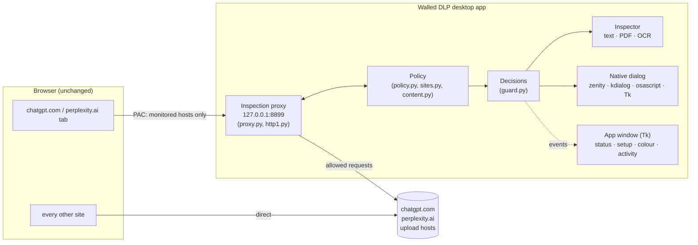
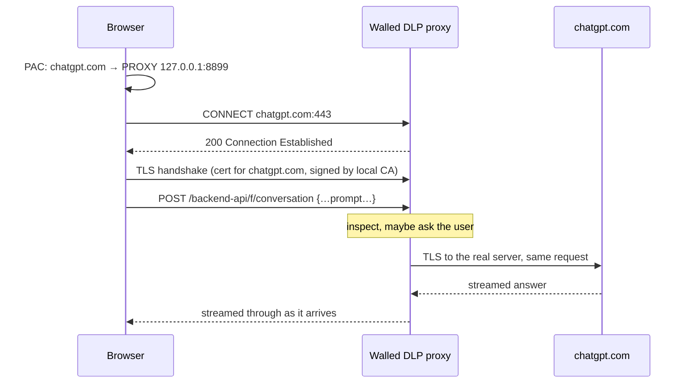
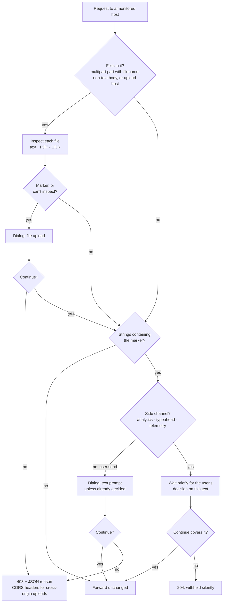

# Architecture

Walled DLP is one desktop process with four parts:



1. **Inspection proxy:** a local HTTPS proxy. Only ChatGPT and Perplexity traffic reaches it.
2. **Policy:** decides, per request, what it carries (text, files) and what to do with it.
3. **Decisions:** when to ask the user, and how one answer covers related requests.
4. **Desktop UI:** the native confirmation dialog, and the app window.

## Why a local inspection proxy

The brief requires a standalone desktop application, with no browser extension, plugin or add-on. A desktop app can see what a browser sends in only a few ways:

| Approach | Problem |
|---|---|
| Watch the screen or accessibility tree, and intercept Enter or clicks | Can't see file contents. Can't reliably *hold* a send and let it continue. Breaks with every UI change. Can't recolour responses |
| Capture packets or filter at OS level (pcap, WFP, NetworkExtension) | Traffic is TLS-encrypted. Without decrypting it, nothing can be inspected |
| Embedded browser (Electron or WebView window showing the sites) | Not the user's browser. Google and Apple sign-in block embedded WebViews. The brief says the sites are used *in a web browser* |
| Attach to the browser over the DevTools protocol | Needs the browser started with a debugging port. Chrome 136+ refuses that on the default profile. Gives full control of every tab to any local process |
| **Local proxy with TLS inspection, for the two sites only** | **Works with any browser, unmodified. Sees exactly what is sent, including files. Can hold a request while the user decides, then forward it byte-for-byte or block it. Can add a stylesheet to the page. This is how enterprise endpoint DLP products work.** |

The costs of the proxy approach, and how each is contained:

- **The browser must trust a local CA.** The CA is generated on the machine and its key never leaves it (file mode `0600`). It carries a critical **name constraint** that limits it to the monitored domains. Even with the key, a certificate it signs for any other site is rejected; a test proves this with OpenSSL.
- **The proxy must not touch anything else.** The PAC script routes only the monitored hosts. If anything else reaches the proxy, it is tunnelled byte-for-byte without decryption.

## Getting traffic to the proxy



- **PAC.** `walled-dlp setup` (or **Connect browser**) points the system proxy settings at a PAC script that returns `PROXY 127.0.0.1:8899` for the monitored hosts and `DIRECT` for everything else.
  - On Linux the PAC is installed inline as a `data:` URL, so it works even while Walled DLP is stopped. The monitored sites then fail to load instead of going direct: the setup fails closed. That Chrome honours `data:` PACs was checked directly.
  - On macOS and Windows it is fetched from `http://127.0.0.1:8899/proxy.pac`.
- **Monitored hosts** (`sites.py`):
  - ChatGPT: `chatgpt.com`, `chat.openai.com`, and the upload host `*.oaiusercontent.com`.
  - Perplexity: `*.perplexity.ai`, the upload hosts `ppl-ai-file-upload.s3.amazonaws.com` and `api.cloudinary.com`. Cloudinary is shared with other websites, so only Perplexity's account path `/v1_1/pplx/` is inspected there; other sites' Cloudinary traffic passes through unchanged.
- **HTTP versions.** The proxy offers HTTP/1.1 to the browser (ALPN) and speaks HTTP/1.1 upstream. Chrome doesn't use QUIC/HTTP3 through a proxy, so nothing bypasses it that way. Responses are streamed chunk by chunk, so ChatGPT's and Perplexity's streamed answers aren't delayed. WebSockets are relayed, with a frame filter on the browser-to-server direction.
- **Cloudflare.** Both sites sit behind Cloudflare. Requests from the proxy's TLS client were accepted on both, logged out, in every live run.

## What the sites actually send

The design was driven by recording real traffic through the proxy while using both sites. Prompts don't travel in just one place:

| Site | User sends | Background copies of the same text | Uploads |
|---|---|---|---|
| ChatGPT, signed in | `POST /backend-api/f/conversation` (JSON, `messages[].content.parts[]`) | telemetry (`/ces/…`), analytics (`/events/…`) | `POST /backend-api/files` with `file_name` returns `upload_url` on `filesNN.oaiusercontent.com`. The browser then `PUT`s the raw bytes there |
| ChatGPT, logged out | `POST /unauth-mweb/conversation/updates`: a **URL-encoded form**. The `prompt` field holds the text, and `conversationState` holds **JSON inside a form field** with earlier turns | same | same flow under `/backend-anon/files` (images only when logged out) |
| Perplexity | `POST /rest/sse/perplexity_ask` (JSON, `query_str`) | **every keystroke** over `wss://suggest.perplexity.ai/suggest/ws` (`{"q": "what is WALLED_SENSI…"}`); analytics `submit query` with `queryStr`, sent *before* the prompt; `suggest.perplexity.ai/search/v2/navigate` | `POST /rest/uploads/create_upload_url` with `filename` returns `s3_bucket_url` and form `fields`. The browser then POSTs multipart to that URL: Cloudinary for images, S3 for documents. This was read from Perplexity's public front-end code; uploads need a signed-in account, so it wasn't observed live |

Two consequences shaped the design:

1. **Find the marker by content, not by endpoint.** `content.py` unwraps whatever a request carries and returns every innermost string that contains the marker. It handles query strings, URL-encoded forms, multipart parts, JSON at any depth, JSON nested inside strings or form fields, and NDJSON. A site renaming an endpoint therefore doesn't open a hole.
2. **One send means several requests, but only one dialog.** That is the job of `guard.py`, below.

## The request pipeline



- **Blocked user sends** get `403` with `{"detail": "Walled DLP blocked this prompt…"}`. Both apps handle that like any failed send:
  - Perplexity shows *Unable to start session.* and ChatGPT shows nothing sent; in both, the prompt stays in the box for the user to edit and resend.
  - ChatGPT shows *Failed to upload file.* with a retry button.

  Blocked uploads to another origin carry CORS headers. Without them the browser would hide the 403 from the app as a network error.
- **Typeahead frames** carrying the marker are dropped from the WebSocket stream. Messages are whole, unmasked, and checked one by one. The proxy strips `Sec-WebSocket-Extensions` from the handshake so that frames are never compressed.
- **File names** for uploads that go straight to storage (ChatGPT's `PUT`) are learned from the create-upload call: its request has the name, and its reply has the signed URL.
- **Upload destinations Walled DLP can't inspect** fail closed. If a create-upload reply points the browser at a storage host outside the monitored list, the reply is replaced with a `403`. The upload fails visibly instead of leaking.

## Decisions (`guard.py`)

Decisions are remembered **by content**. A remembered decision covers a text only if that text is *part of* the decided text. Typeahead prefixes, verbatim analytics copies and the same message re-sent in the next turn's history are covered. An edited, longer prompt is new content and asks again.

| Situation | Behaviour |
|---|---|
| User send, text not yet decided | Native dialog. One dialog on screen at a time |
| Requests queued behind that dialog with the same text | Follow its answer, Cancel included: they are copies of the same send |
| A later send of text the user approved | Allowed without asking (that site already has it), for 12 hours |
| A later send of text the user cancelled | **Asks again.** A Cancel never silences a deliberate retry |
| Side channel (analytics, typeahead, telemetry) | Never asks. Waits up to 3 s, or longer while a dialog is open, for a Continue covering it. Otherwise withheld. Perplexity's analytics event arrives *before* the prompt, so it waits for the prompt's dialog |
| Typeahead WebSocket frame | Can't wait without stalling the socket: passes only if already approved |
| File | Remembered by SHA-256: Continue for 10 minutes, Cancel for 5 seconds. That absorbs the automatic retries ChatGPT makes after a failed upload (three `PUT`s were observed) |
| No dialog backend can run | Blocked |
| Unanswered dialog | Counts as Cancel after `dialog_timeout` (300 s) |

These rules came out of testing against the real sites. An earlier version remembered a Cancel for a few seconds and matched containment both ways. A user who cancelled, appended *"Answer yes or no."* and pressed Enter was then blocked silently, because the old text was contained in the new one. The end-to-end and live tests now cover exactly that sequence.

## Content inspection

`inspector.py` picks a type by **magic bytes first**, then extension or MIME type. A PDF renamed to `.txt` is still parsed as a PDF.

| Type | What is searched |
|---|---|
| Text (`.txt`, `.md`, `.csv`, code, …) | Decoded content (UTF-8, UTF-8/16 with BOM, BOM-less UTF-16, Latin-1) |
| PDF | Document metadata, form-field values, page text (pypdf), annotation and comment text, then **OCR of embedded images** for scanned pages (up to 20 images) |
| Image (PNG, JPEG, GIF, WebP, BMP, TIFF) | Metadata bytes (PNG `tEXt`, EXIF), then **OCR** in three passes: as-is (upscaled when small), high-contrast greyscale, and inverted (light text on dark) |
| Anything else | Raw bytes in UTF-8 and UTF-16 (catches the marker in unknown formats) |

**Matching.**
- Prompt text and file text are matched case-insensitively.
- OCR output is matched *fuzzily*. Both sides are mapped to a canonical alphabet (`0→O`, `1/l/I→I`, `5→S`, …) and stripped of everything that isn't a letter or digit. That catches `WALLED SENSITIVE`, `WALLED_SENS1TIVE` and a marker split across two OCR lines.

**OCR engine.** RapidOCR (PaddleOCR models on ONNX Runtime) installs from pip with no system packages. If it isn't available, Tesseract is used when installed. The models load in the background when the app starts. Inspection runs on worker threads, so OCR never blocks the proxy's event loop.

## Native dialogs

`dialogs.py` runs every dialog as a **child process**, so a dialog toolkit can't crash or hang the app.

| Platform | Backend (first available) | Notes |
|---|---|---|
| Linux | `zenity` (GTK) → `kdialog` (KDE) → Tk | Buttons labelled **Continue** / **Cancel**, Cancel focused by default, Pango markup escaped |
| macOS | `osascript` `display dialog` → Tk | Caution icon; Cancel is the default and Esc button |
| Windows | Tk (native Win32 widgets) | Always on top |

Each dialog shows four things:
- the kind of content (text prompt or file upload);
- the site;
- the prompt excerpt centred on the marker, or the file name, type and size;
- where the marker was found (for example `page 2 text`, `text in image (OCR)`).

## Response recolouring (`pagestyle.py`)

Both sites are single-page apps: the HTML document loads once and every answer renders into it. So the proxy adds one `<style>` element to that document.

- **Inserted as the page streams.** The proxy asks the server for an uncompressed document (`Accept-Encoding: identity`; gzip and deflate are also decoded). It inserts the `<style>` right after `<head …>` and re-chunks the rest straight through. Nothing beyond the first few kilobytes is buffered, so pages load as fast as before.
- **CSP-aware.** If the page's Content-Security-Policy restricts inline styles, a per-response nonce is added for this one element only. Directives that already allow `'unsafe-inline'` are left alone, because adding a nonce there would switch `'unsafe-inline'` off.
- **Selectors** (in `sites.py`):
  - ChatGPT's assistant turns: `[data-message-author-role="assistant"] .markdown` when signed in, `[data-message-role="assistant"] [data-assistant-markdown]` when logged out.
  - Perplexity's answers: `[data-renderer="lm"]`. Perplexity renders the user's own question with the same renderer inside `[data-message-bubble]`, so that is excluded.
- **Colour.** Violet `#6d28d9`, or `#c4b5fd` on dark themes, or the colour chosen in the app. Invalid colour strings are rejected, so the setting can't inject CSS.

## Failure handling

| Failure | Result |
|---|---|
| Walled DLP not running (Linux) | ChatGPT and Perplexity don't load: the inline PAC still routes them to the stopped proxy |
| Walled DLP not running (macOS, Windows) | The browser can't fetch the PAC and goes direct (documented limitation) |
| No dialog backend | Blocked |
| Dialog unanswered | Cancel after `dialog_timeout` |
| File can't be inspected (corrupt, encrypted, too big) | `on_inspection_error`: `ask` (default, the dialog explains why), `allow` or `block` |
| Inspection crashes on a hostile file | Caught. Treated as "can't inspect"; a raw-bytes check still runs |
| Upload destination not inspectable | The create-upload reply is replaced with a 403 |
| Upstream unreachable | 502 to the browser |
| Port already in use (second instance) | The app window says so; protection is not duplicated |

## Security and privacy

- The proxy listens on **127.0.0.1 only**.
- The CA key is generated locally, stored with mode `0600`, and **name-constrained** to the monitored domains (critical extension). If the monitored domains change, a new CA is generated and must be trusted again.
- Only the monitored hosts are decrypted. Every other connection is a blind tunnel, and with the PAC in place other hosts never reach the proxy at all.
- The audit log and the app's activity list hold site, file names and decisions, **never prompt text or file contents**.
- Nothing is sent anywhere except to the site the user was already talking to.

## Code map

```
walled_dlp/
  app.py         Tk desktop window: protection status, Connect/Disconnect browser, colour, activity
  cli.py         walled-dlp command (app, run, setup, status, check, dialog-test)
  service.py     assembles CA + guard + policy + proxy; runs it on a background thread
  proxy.py       asyncio HTTPS proxy: CONNECT, TLS with per-host certs, HTTP/1.1, WebSocket relay
  http1.py       minimal HTTP/1.1: heads, bodies, chunked streaming, gzip/deflate
  certs.py       local CA (name-constrained) and per-host certificates
  policy.py      what to do with each request/response; PAC; block replies
  sites.py       ChatGPT and Perplexity: hosts, upload hosts, side channels, response selectors
  content.py     extract marker-bearing strings and files from any request encoding
  guard.py       decisions, content memory, side channels, audit log, events
  inspector.py   text / PDF / image inspection
  ocr.py         RapidOCR (Tesseract fallback), loaded lazily
  detector.py    exact and OCR-tolerant marker matching, excerpts
  dialogs.py     native Continue/Cancel dialogs (zenity, kdialog, osascript, Tk)
  pagestyle.py   response-colour CSS, streaming HTML injection, CSP nonces
  system.py      trust the CA and set the PAC per OS; undo
  config.py      settings (defaults < config.json < WALLED_DLP_* env)
tests/           pytest: unit + proxy integration over real TLS
tests/e2e/       real Chrome through the real app (fixtures) and live-site smoke tests
```

## How it was verified

- **Wire formats** of both sites were recorded through the proxy (logged out). Perplexity's upload flow was read from its public front-end code.
- **107 Python tests.** The proxy tests run over real sockets with TLS verified against the local CA, plus a fake upstream that records exactly what got through.
- **13 browser tests:** real Chrome 158, routed by PAC through the real app, against local stand-ins for both sites. Only the dialog answer is scripted.
- **Live tests** against real chatgpt.com and perplexity.ai:
  - Perplexity: typeahead frames dropped, Cancel keeps the question in the box, Continue sends it, the answer is violet and the question bubble isn't.
  - ChatGPT: Cancel keeps the text, edit and resend asks again, Continue gets an answer, the answer is violet.
  - ChatGPT image upload: OCR finds the marker, the dialog names `sensitive-screenshot.png`, Cancel results in *Failed to upload file.* with ChatGPT's automatic retries blocked silently, and a clean image raises no dialog.
- **Not verified here:**
  - the GNOME/NSS setup run against this machine's real settings (it needs `libnss3-tools`, and changing system settings was left to the user);
  - signed-in uploads to Perplexity;
  - macOS and Windows.
